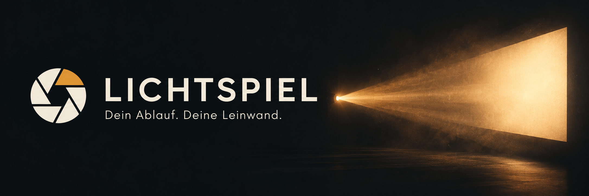
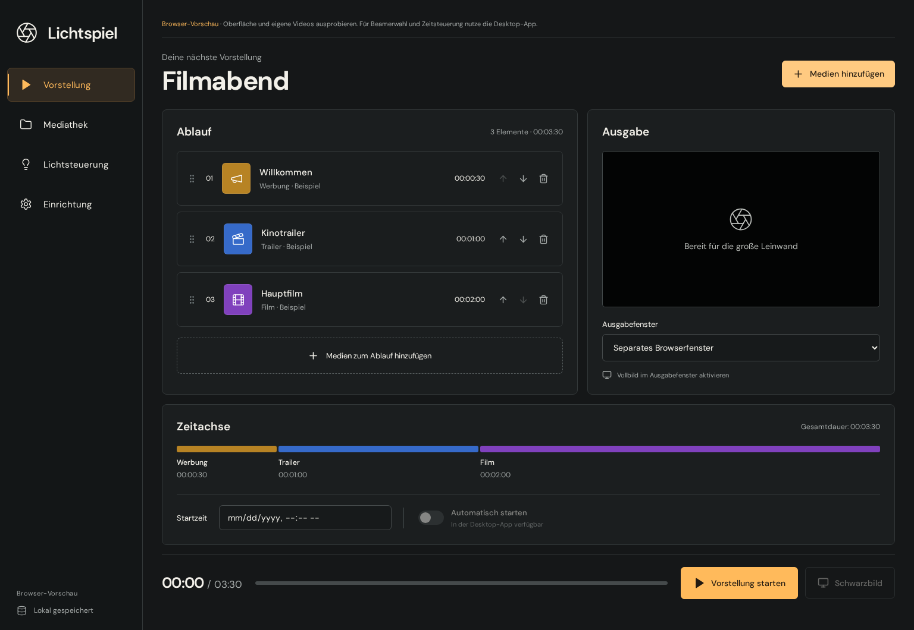
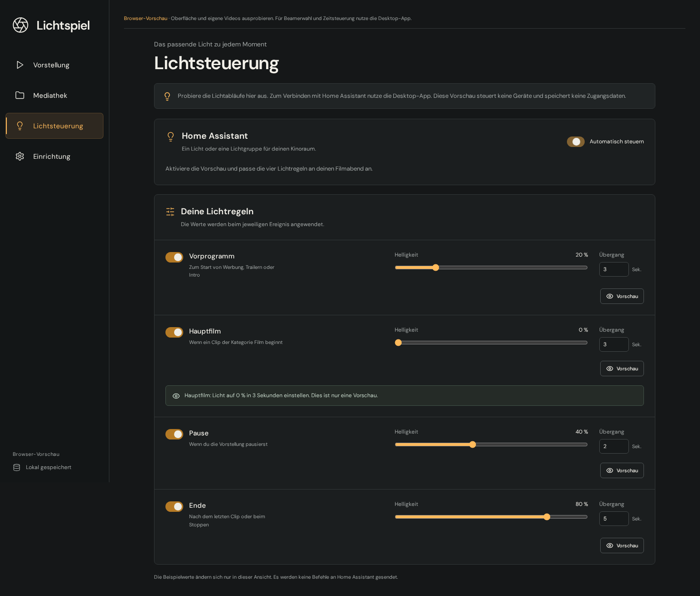

<p align="center">
  
</p>

<h1 align="center">Lichtspiel</h1>

<p align="center">
  <strong>Dein Ablauf am Rechner. Dein Film auf der großen Leinwand.</strong><br>
  Eine offene Kinoregie für Werbung, Trailer, Filme und das passende Licht.
</p>

<p align="center">
  <a href="https://github.com/nikpottbecker/lichtspiel/actions/workflows/ci.yml"></a>
  <a href="LICENSE"></a>
  <a href="docs/roadmap.md"></a>
  <a href="docs/getting-started.md"></a>
</p>

<p align="center">
  <a href="#schnellstart">Schnellstart</a> ·
  <a href="docs/getting-started.md">Erste Vorstellung</a> ·
  <a href="docs/home-assistant.md">Lichtsteuerung</a> ·
  <a href="docs/roadmap.md">Roadmap</a> ·
  <a href="CONTRIBUTING.md">Mitmachen</a>
</p>

---

Lichtspiel bringt den kleinen Filmabend in einen vorbereiteten Ablauf: erst Werbung, dann Trailer, schließlich der Hauptfilm. Du bedienst die Vorstellung am Computer, während ein eigener Player das Bild auf den Beamer ausgibt. Auf Wunsch dimmt Home Assistant dazu die Kinolichter.

Für Heimkinos, Vereine und eigene Filmprojekte. Lokal auf deinem Rechner, ohne Lichtspiel-Konto.

> [!NOTE]
> **Version 0.1.0 ist eine Entwicklungsvorschau aus dem Quellcode.** Signierte Installationspakete sind noch nicht veröffentlicht. Beamer, Audio und reale Lampen müssen am jeweiligen Mac- oder Windows-Aufbau geprüft werden.

<p align="center">
  
</p>
<p align="center"><sub>Die tatsächliche Oberfläche mit einem Beispielablauf. Eigene Videodateien werden lokal importiert.</sub></p>

## Alles für den Ablauf

| Vorbereiten                                                                                             | Vorführen                                                                                                     |
| ------------------------------------------------------------------------------------------------------- | ------------------------------------------------------------------------------------------------------------- |
| **Geführte Einrichtung** — Player, Bildschirm und Tonausgabe auswählen.                                 | **Getrennte Ausgabe** — Bedienung am Rechner, Video über mpv auf dem gewählten Bildschirm.                    |
| **Mediathek** — lokale Dateien importieren, suchen und als Werbung, Trailer, Intro oder Film einordnen. | **Direkte Kontrolle** — starten, pausieren, fortsetzen, zum nächsten Clip wechseln oder Schwarzbild schalten. |
| **Ablaufeditor** — Clips per Drag-and-drop oder Pfeilbuttons ordnen, Laufzeiten und Reihenfolge prüfen. | **Geplanter Beginn** — die Vorstellung einmalig zu einer festgelegten Uhrzeit starten.                        |
| **Lokales Speichern** — den Ablauf beim nächsten Öffnen wiederfinden.                                   | **Lichtregeln** — Helligkeit und Dimmzeit passend zu Vorprogramm, Film, Pause und Ende einstellen.            |

Ein geplanter Start setzt eine geöffnete App und einen laufenden Rechner voraus. Schwarzbild pausiert Bild und Ton. Die Desktop-App prüft vor dem Start, ob die Dateien noch verfügbar sind.

## Schnellstart

Du brauchst **Git**, **Node.js 22 oder 24 mit npm** und für die Desktop-Wiedergabe **[mpv](https://mpv.io/installation/)**.

```sh
git clone https://github.com/nikpottbecker/lichtspiel.git
cd lichtspiel
npm ci
npm run dev
```

Auf macOS lässt sich mpv beispielsweise mit `brew install mpv` installieren. Unter Windows wählst du einen Build über die [mpv-Installationsseite](https://mpv.io/installation/). Im Einrichtungsassistenten kannst du den Player bei Bedarf selbst auswählen.

**Erst die Oberfläche ausprobieren?** Starte stattdessen `npm run dev:web` und öffne die angezeigte lokale Adresse. Die Browser-Vorschau benötigt kein mpv.

Die [Startanleitung](docs/getting-started.md) führt vom angeschlossenen Beamer bis zur ersten Vorstellung und erklärt häufige Probleme.

## Desktop und Browser

| Funktion                                | Desktop-App                      | Browser-Vorschau                   |
| --------------------------------------- | -------------------------------- | ---------------------------------- |
| Einrichtung, Mediathek und Ablaufeditor | Ja                               | Ja                                 |
| Lokale Videos abspielen                 | mpv                              | HTML-Video, abhängig vom Browser   |
| Medien speichern                        | Verweise auf die Originaldateien | Kopien im lokalen Browserspeicher  |
| Bildschirm und Tonausgabe wählen        | Ja                               | Ausgabefenster manuell verschieben |
| Automatisch zur Startzeit beginnen      | Ja, solange die App geöffnet ist | Nein                               |
| Home-Assistant-Lampen steuern           | Optional                         | Nur Vorschau, keine Gerätebefehle  |

## Licht aus. Film an.

Home Assistant verbindet Lichtspiel mit einer Lampe oder Lichtgruppe in deinem Kinoraum. Für jede Situation bestimmst du selbst Helligkeit und Übergangszeit.

| Moment                      | Voreinstellung |
| --------------------------- | -------------- |
| Werbung, Trailer oder Intro | 20 %           |
| Hauptfilm                   | Aus            |
| Pause                       | 40 %           |
| Ende oder manueller Stopp   | 80 %           |

<p align="center">
  
</p>

Die Automatik ist anfangs ausgeschaltet. Verbindungstest und Vorschau verändern kein Licht; der Knopf **Licht jetzt testen** sendet ausdrücklich einen Gerätebefehl. Ein Lichtfehler unterbricht die Filmwiedergabe nicht.

**[Home Assistant einrichten →](docs/home-assistant.md)**

## Ein klarer erster Stand

Lichtspiel verwendet **React + TypeScript** für die Oberfläche, **Electron** für den Desktop und **mpv** als separaten Wiedergabeprozess. Die Architektur bleibt klein genug, um sie selbst zu verstehen und zu erweitern.

Automatisierte Tests decken Ablaufplanung, Dateiprüfung, Player-Protokoll und Lichtregeln ab. Browser-Tests prüfen außerdem den Weg vom Import bis zur tatsächlichen Videoausgabe. Die mpv-Steuerung wurde unter Linux mit echten Testclips und Nullausgabe geprüft; das ersetzt keine Bild- und Tonprüfung auf macOS oder Windows.

Der aktuelle Umfang umfasst weder DCP/KDM-Kinopakete noch Projektor- und Vorhangautomation. Nahtlose oder bildgenaue Übergänge zwischen beliebigen Dateien sind nicht zugesichert.

## Dokumentation

| Du möchtest …                              | Hier geht es weiter                                                                         |
| ------------------------------------------ | ------------------------------------------------------------------------------------------- |
| die erste Vorstellung einrichten           | [Startanleitung](docs/getting-started.md)                                                   |
| deine Kinolichter anbinden                 | [Home Assistant](docs/home-assistant.md)                                                    |
| lokal entwickeln, testen oder Pakete bauen | [Entwicklung](docs/development.md)                                                          |
| den technischen Aufbau verstehen           | [Architektur](docs/architecture.md)                                                         |
| den nächsten Ausbau verfolgen              | [Roadmap](docs/roadmap.md) · [Änderungen](CHANGELOG.md)                                     |
| einen Fehler melden oder mitentwickeln     | [Mitmachen](CONTRIBUTING.md) · [Issues](https://github.com/nikpottbecker/lichtspiel/issues) |

## Lizenz und Grundlagen

Der eigene Anwendungscode steht unter der **[MIT-Lizenz](LICENSE)**. mpv wird separat installiert und behält seine eigene Lizenz. Alle weiteren Hinweise findest du unter [Fremdsoftware und Lizenzen](THIRD_PARTY.md).

Lichtspiel ist ein eigenständiges Projekt. Es übernimmt keinen Quellcode aus QLab, PreShow Experience oder CasparCG.
