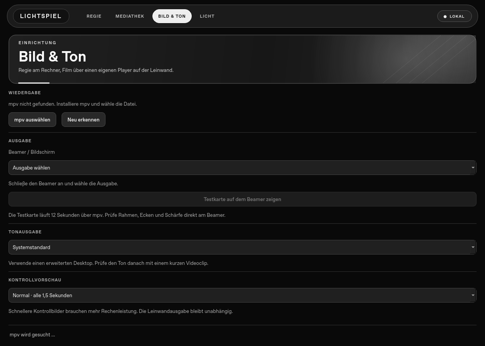

# Deine erste Vorstellung

[← Zur Projektübersicht](../README.md)

Diese Anleitung richtet Lichtspiel für einen Rechner mit angeschlossenem Beamer ein. Die Desktop-App ist für macOS und Windows vorgesehen. Version 0.1.0 wird derzeit aus dem Quellcode gestartet.

## 1. Programme installieren

Für die native App brauchst du Git, Python 3.12 oder neuer und [mpv](https://mpv.io/installation/). mpv übernimmt das Abspielen der Videodateien; es wird nicht mit Lichtspiel ausgeliefert.

Auf einem Mac mit Homebrew:

```sh
brew install mpv
```

Unter Windows findest du Builds über die [mpv-Installationsseite](https://mpv.io/installation/). Entpacke den Player an einen dauerhaften Ort. Seine ausführbare Datei kannst du später unter **Bild & Ton** auswählen.

Lichtspiel herunterladen und auf macOS starten:

```sh
git clone https://github.com/nikpottbecker/lichtspiel.git
cd lichtspiel
python3 -m venv .venv-native
.venv-native/bin/python -m pip install -r native/requirements.txt
.venv-native/bin/python native/main.py
```

Unter Windows nutzt du nach dem Klonen `py -3.12 -m venv .venv-native`, dann `.\.venv-native\Scripts\python.exe -m pip install -r native/requirements.txt` und `.\.venv-native\Scripts\python.exe native\main.py`.

Für die erste Installation werden Pakete heruntergeladen. Die lokale Wiedergabe benötigt danach keinen Lichtspiel-Server.

## 2. Beamer und Ton verbinden

1. Beamer anschließen und in den Betriebssystemeinstellungen **erweiterten Desktop** wählen.
2. Lichtspiel öffnen und einen Namen für die Vorstellung eingeben.
3. In **Bild & Ton** prüfen, ob mpv erkannt wurde. Andernfalls **mpv auswählen** verwenden.
4. Den Beamer als Wiedergabebildschirm auswählen. Nach dem Anschließen eines neuen Geräts **Neu erkennen** verwenden.
5. Die gewünschte Tonausgabe auswählen.

Klicke nach der Bildschirmauswahl auf **Testkarte auf dem Beamer zeigen**. Die Desktop-App zeigt sie 12 Sekunden lang über denselben mpv-Ausgabeweg wie den Film. Prüfe direkt am Beamer den äußeren Rahmen, alle vier Ecken, Kreisform, Schärfelinien und Farbbalken. Die Bildschirmreihenfolge von Betriebssystem und Player kann sich je nach Aufbau unterscheiden; die Testkarte macht eine falsche Zuordnung sichtbar.

Spiele danach einen kurzen Clip ab und prüfe Bildbewegung sowie Ton am richtigen HDMI-Gerät oder Audiointerface. Die Testkarte ist stumm und beweist weder die Qualität eines Filmcodecs noch die Audioausgabe.



## 3. Den Ablauf erstellen

Mit **Medien hinzufügen** importierst du lokale Videos. Sie erscheinen in der Mediathek und werden zum Ablauf hinzugefügt. Die Desktop-App liest ihre Laufzeit mit mpv.

In der Mediathek kannst du jeder Datei eine Kategorie geben: **Werbung**, **Trailer**, **Intro** oder **Film**. Die Kategorie beeinflusst auch die optionale Lichtautomation.

Ordne die Clips in der **Regie** über **Nach oben** und **Nach unten**. Die Ablaufliste zeigt Reihenfolge und Laufzeiten. Derselbe Clip darf mehrfach vorkommen.

Änderungen werden automatisch lokal gespeichert. Die Desktop-App speichert Verweise auf die Originaldateien; verschiebe oder lösche diese Dateien nicht, solange du sie für deine Vorstellung brauchst.

Mit **Wiedergabe prüfen** siehst du vorab, ob Medien, Player und Ausgabe bereit sind. Die App prüft die Dateien beim Start erneut.

## 4. Vorführen

| Bedienung           | Verhalten                                                        |
| ------------------- | ---------------------------------------------------------------- |
| Vorstellung starten | Prüft die Dateien und beginnt mit dem ersten Clip.               |
| Pause               | Hält die laufende Wiedergabe an.                                 |
| Fortsetzen          | Setzt den pausierten Clip fort.                                  |
| Nächster Clip       | Wechselt zum folgenden Eintrag im Ablauf.                        |
| Schwarzbild         | Pausiert Bild und Ton und schaltet die Videoausgabe auf Schwarz. |
| Stopp               | Beendet die laufende Vorstellung.                                |

Während einer laufenden Vorstellung oder einer aktivierten Startplanung sind Änderungen am Ablauf gesperrt.

## 5. Einen Start planen

Trage unter **Startzeit** Datum und Uhrzeit ein und wähle **Einplanen**. Der Zeitpunkt gilt einmalig für den aktuellen Ablauf.

Die App muss geöffnet bleiben und der Rechner muss laufen. Lichtspiel weckt keinen ausgeschalteten oder schlafenden Computer. Ein um mehr als zehn Sekunden verpasster Start wird übersprungen; eine bereits laufende Vorstellung wird nicht unterbrochen. Nach einem Neustart der App musst du die Planung erneut aktivieren.

Die [Lichtsteuerung mit Home Assistant](home-assistant.md) lässt sich unabhängig davon vorbereiten.

## Im Browser ausprobieren

Installiere dafür Node.js 22 oder 24, führe `npm ci` aus und starte mit `npm run dev:web` die Browser-Vorschau. Sie importiert lokale Videos und speichert Kopien in IndexedDB. Diese Kopien belegen Speicher auf deinem Gerät und gehen beim Löschen der Websitedaten verloren.

Beim Start öffnet sich ein separates Ausgabefenster. Erlaube das Popup und klicke darin gegebenenfalls auf **Wiedergabe freigeben**, damit der Browser Bild und Ton starten darf. Du kannst das Fenster manuell auf einen zweiten Bildschirm verschieben und dort Vollbild aktivieren.

Unterstützte Codecs und automatische Wiedergabe hängen vom Browser ab. Die Browser-Vorschau bietet weder geplante Starts noch echte Home-Assistant-Aufrufe.

## Wenn etwas nicht funktioniert

| Problem                              | Nächster Schritt                                                                                         |
| ------------------------------------ | -------------------------------------------------------------------------------------------------------- |
| mpv wird nicht gefunden              | Den Player installieren, **Neu erkennen** oder **mpv auswählen** verwenden.                              |
| Datei kann nicht importiert werden   | Dieselbe Datei direkt in mpv testen. Eine vorhandene Dateiendung garantiert keinen unterstützten Inhalt. |
| Falscher Bildschirm                  | Erweiterte Anzeige prüfen, Geräte neu erkennen und einen kurzen Clip zur Zuordnung abspielen.            |
| Kein Ton                             | Audioausgabe und Lautstärke in Lichtspiel, Betriebssystem, Beamer und Verstärker prüfen.                 |
| Browser öffnet keine Ausgabe         | Popup erlauben und erneut starten.                                                                       |
| Browser zeigt „Wiedergabe freigeben“ | Im Ausgabefenster auf den Knopf klicken.                                                                 |
| Gespeicherte Datei fehlt             | Die Datei wieder an ihren ursprünglichen Ort legen oder neu importieren und im Ablauf ersetzen.          |
| Licht reagiert nicht                 | Den [Home-Assistant-Leitfaden](home-assistant.md) verwenden; die Filmwiedergabe bleibt davon unabhängig. |

Vor der ersten öffentlichen Vorführung solltest du den vollständigen Ablauf mit den tatsächlichen Dateien, Bildformaten, Bildwiederholraten und Audioverbindungen durchlaufen lassen. Beamer- und Audiokompatibilität auf realer macOS-/Windows-Hardware ist noch nicht umfassend bestätigt.
