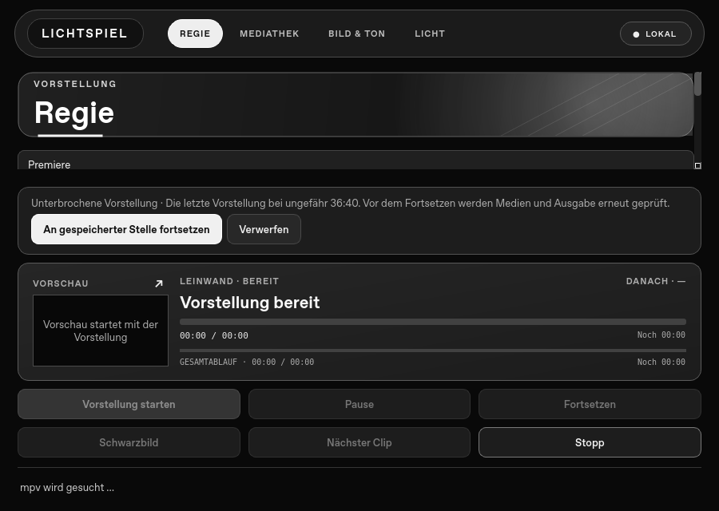
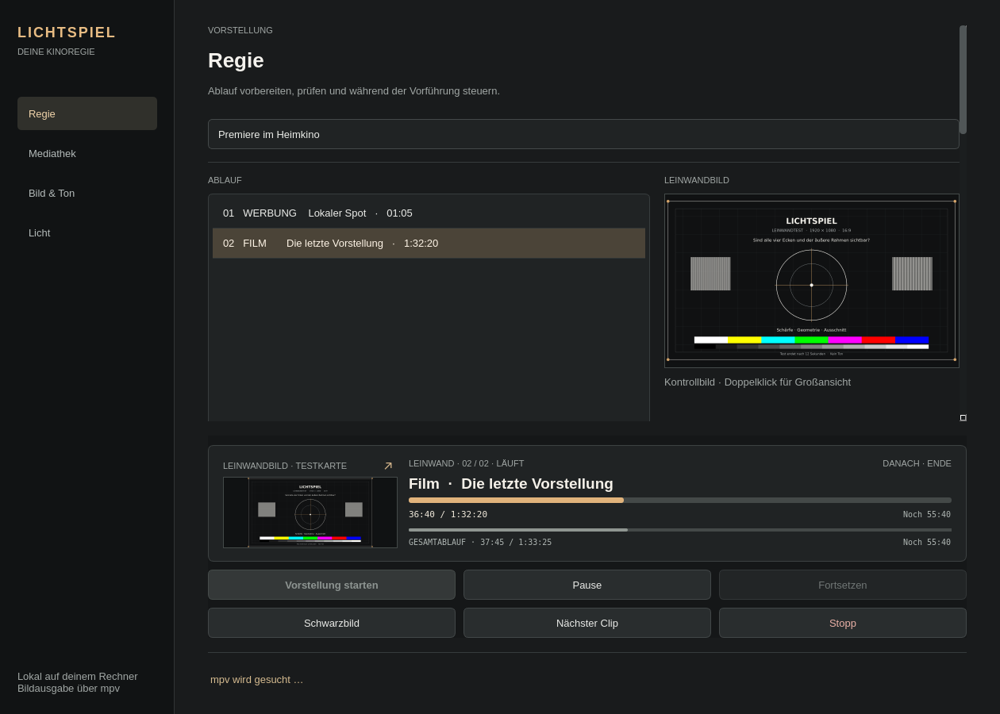
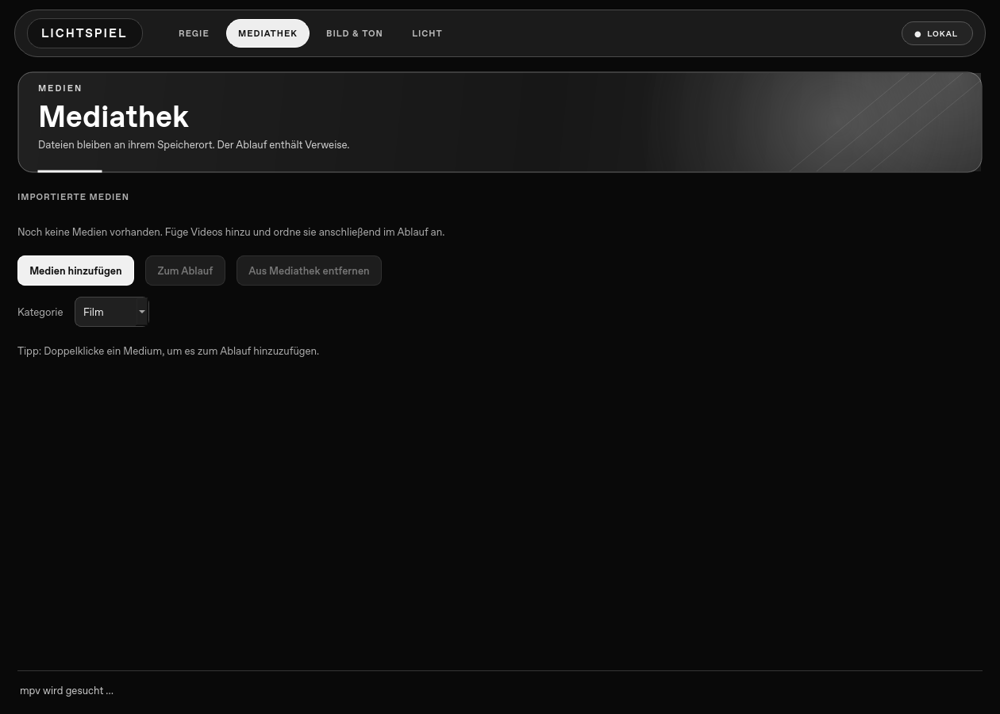
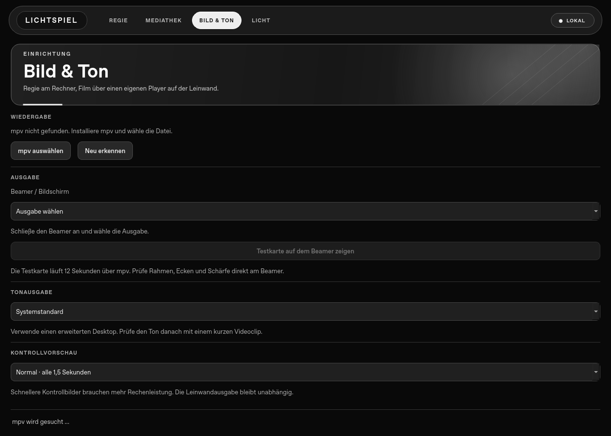
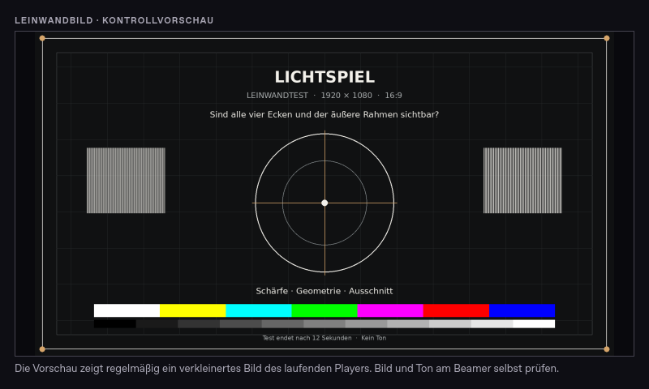
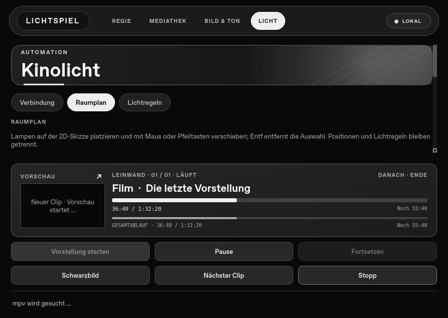
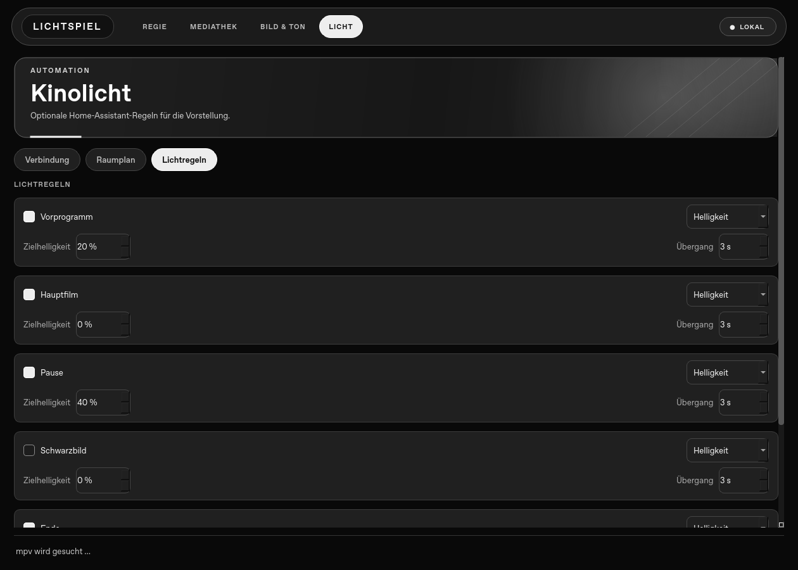
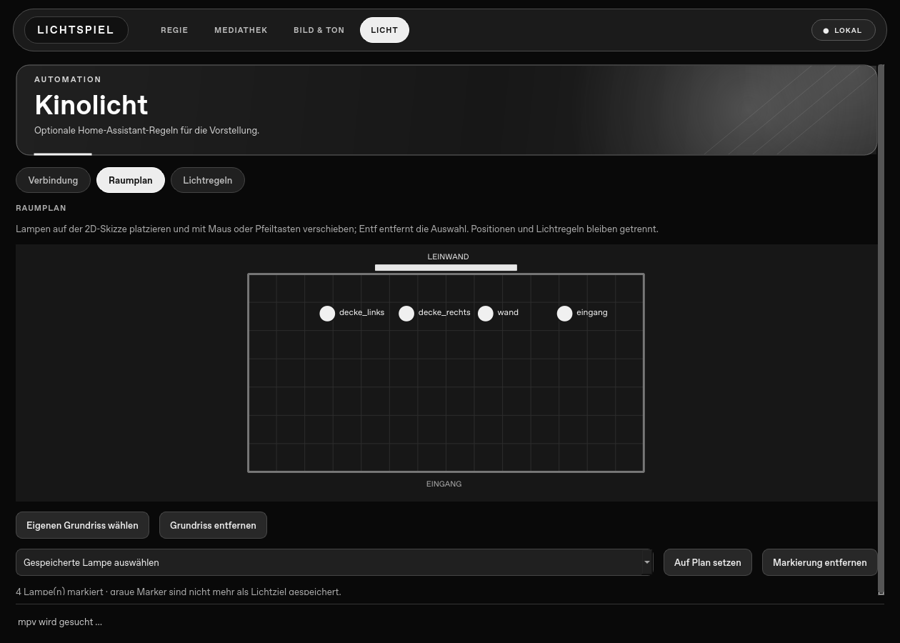

# Native Desktop-Vorschau

Die neue Lichtspiel-Oberfläche besteht aus **Qt Widgets (PySide6)**. Sie enthält keinen eingebetteten Browser und startet keinen Webserver. Die Videodekodierung und Leinwandausgabe bleiben im eigenen mpv-Prozess; Dateiprüfung, Import, Gerätesuche und Home-Assistant-Aufrufe laufen außerhalb des UI-Threads.

Die Qt-Version ist eine **Entwicklungsvorschau**, keine freigegebene Kinosaal-Version. Insbesondere Bildschirmauswahl, Ton, lange Filme, App-Beenden und die System-Schlüsselbunde müssen auf echten Macs und Windows-Rechnern mit Beamer geprüft werden. Die [Geräteprüfung](../docs/hardware-test.md) dient als Protokoll.

## Aus dem Quellcode starten

Benötigt werden Python 3.12 oder neuer und [mpv](https://mpv.io/installation/). Aus dem Repository:

```sh
python -m venv .venv-native
# macOS: source .venv-native/bin/activate
# Windows PowerShell: .venv-native\Scripts\Activate.ps1
python -m pip install -r native/requirements.txt
python native/main.py
```

Die App erkennt mpv auf dem Suchpfad und an üblichen Installationsorten; andernfalls lässt sich die ausführbare Datei unter **Bild & Ton** auswählen. Dort zuerst den Beamer wählen und die Testkarte prüfen. Danach einen kurzen Clip für Bildbewegung und Ton abspielen.

## Stand des Umbaus

| Bereich                                                   | Qt-Vorschau                                                                                                                  |
| --------------------------------------------------------- | ---------------------------------------------------------------------------------------------------------------------------- |
| Projektdatei, Mediathek, Kategorien und geordneter Ablauf | Vorhandene Electron-Projektdatei wird gelesen und weiterverwendet                                                            |
| mpv-Wiedergabe                                            | Separater Prozess mit asynchroner IPC; Pause, Fortsetzen, Schwarzbild, nächster Clip und Stopp                               |
| Live-Regie                                                | Clip- und Gesamtablauf, Restzeiten, nächster Clip und Vorführtasten bleiben während der Wiedergabe auf allen Seiten sichtbar |
| Leinwandvorschau                                          | Regelmäßig aktualisiertes Kontrollbild direkt aus mpv; vergrößerbar, ohne zweiten Videodecoder                               |
| Player-Überwachung                                        | Eine ausbleibende IPC-Antwort wird nach 12 Sekunden als Fehler gemeldet                                                      |
| Wiederaufnahme                                            | Letzter Clip und ungefähre Position werden lokal gespeichert; Fortsetzen erfordert einen Klick und erneute Startprüfung      |
| Bild & Ton                                                | Bildschirmauswahl, Tongerät, mpv-Erkennung und native mpv-Testkarte                                                          |
| Startprüfung und Startplanung                             | Dateiprüfung im Hintergrund; einmaliger Start bei offener App                                                                |
| Home Assistant                                            | Mehrere Lampen, Szenen oder Helligkeit je Ereignis, optional Schwarzbild, Gerätesuche                                        |
| 2D-Lichtplan                                              | Verschiebbare Marker für gespeicherte Lampen, optional eigener Grundriss als lokales Bild                                    |
| Kleine Fenster                                            | Regietasten bleiben sichtbar, der Ablauf scrollt                                                                             |

Der Bildschirm wird für die Qt-Version als `nativeDisplayId` in `settings.json` gespeichert. Dadurch überschreibt sie die Electron-Bildschirmauswahl im gemeinsamen Projekt nicht. Öffne **nicht beide Apps gleichzeitig** mit demselben Projekt. Home-Assistant-Regeln können aus der bisherigen Konfiguration übernommen werden; das verschlüsselte Electron-Token ist nicht übertragbar. Gib es einmal in der Qt-App neu ein und aktiviere die Automatik dort ausdrücklich.

Bei einer Unterbrechung merkt sich die Qt-App den Ablauf, den aktuellen Clip und etwa alle fünf Sekunden die Position in `show-recovery.json` im lokalen Konfigurationsverzeichnis. Nach einem Neustart bleibt die Leinwand aus. **An gespeicherter Stelle fortsetzen** prüft Dateien, Ablauf und gewählte Ausgabe erneut; ein veränderter Ablauf kann nicht versehentlich an einer anderen Stelle gestartet werden. **Verwerfen** erlaubt einen neuen Start. Ein regulärer Stopp oder das Ende der Vorstellung entfernt den Punkt. Beim bestätigten Schließen während der Wiedergabe bleibt er erhalten. Die Position kann nach einem Absturz um bis zu ungefähr fünf Sekunden zurückliegen; das ist kein vollständiges Vorführprotokoll.



Auf der Lichtseite wählst du direkt zwischen **Verbindung**, **Raumplan** und **Lichtregeln**. Speichere unter Verbindung zuerst Adresse und Token mit ausgeschalteter Automatik. Danach kannst du **Lampen laden** und Ziele auswählen. Bis zu 20 `light.*`-Entitäten oder Lichtgruppen lassen sich gemeinsam dimmen. Jede Regel wählt entweder Helligkeit und Übergangszeit oder eine Home-Assistant-Szene; Szenen eignen sich für Farben und mehrere Räume. Die Schwarzbild-Regel ist standardmäßig **aus**. **Lampen laden** und **Verbindung prüfen** lesen nur Daten. Geänderte Regeln müssen vor einem Test gespeichert werden. Wiederholte Clips derselben Vorprogramm-Kategorie senden keinen doppelten Befehl; ausstehende ältere Automatikbefehle werden bei schnellen Wechseln verworfen. Fehler erscheinen ohne modales Fenster und stoppen den Film nicht.

Während der Vorstellung bleibt die Regie auch beim Wechsel zur Licht- oder Einrichtungsseite unten erreichbar. Der obere Seiteninhalt scrollt in kleinen Fenstern unabhängig davon. Nach Stopp oder Ende erscheint die Regie wieder nur auf der Vorstellungsseite.

Die Regie holt standardmäßig ungefähr alle 1,5 Sekunden ein JPEG-Kontrollbild **aus dem laufenden mpv-Prozess**. Es wird außerhalb des UI-Threads auf Monitorgröße verkleinert. Unter **Bild & Ton** lässt sich die Vorschau ausschalten oder auf 0,5 beziehungsweise 3 Sekunden stellen. Mit dem Pfeil am Bild oder einem Doppelklick öffnest du eine größere, nicht modale Ansicht. Bei Pause bleibt das letzte Bild stehen; Schwarzbild zeigt bewusst kein altes Bild. Ein Vorschaufehler wird nur in der Vorschau angezeigt und stoppt die Vorstellung nicht. Die Vorschau ist kein Ersatz für die Kontrolle von Bild und Ton direkt am Beamer. Die Abtastrate ist bewusst begrenzt; sie ist kein flüssiger zweiter Videostream.













Auf der Lichtseite können gespeicherte `light.*`-Ziele auf eine **2D-Raumskizze** gesetzt und mit der Maus verschoben werden. Ausgewählte Marker lassen sich auch mit den Pfeiltasten bewegen (mit Umschalt schneller) und mit Entf entfernen. Optional lässt sich ein eigenes Grundrissbild als Hintergrund wählen; die App speichert eine verkleinerte Kopie lokal. Marker und Bild bleiben auf diesem Rechner und werden nicht an Home Assistant gesendet. Graue Marker zeigen Ziele, die inzwischen aus der Lichtkonfiguration entfernt wurden. Während der Vorstellung bleibt der Plan lesbar, aber gesperrt. Die Positionen ändern keine Lichtregeln und lösen keine Befehle aus.



Die Vorschau liefert noch keine signierten Installationspakete. Der [Qt-Build-Workflow](../.github/workflows/native-desktop.yml) erzeugt unsignierte Testartefakte für macOS und Windows. mpv wird separat installiert.

## Prüfen und paketieren

```sh
python -m unittest discover -s native/tests -v
python native/build.py
```

Der Paketbau nutzt PyInstaller und schreibt nach `release/native/`. Die Tests enthalten einen simulierten mpv-IPC-Prozess; sie ersetzen keine Kontrolle von Bild und Ton auf einem realen Beamer.
